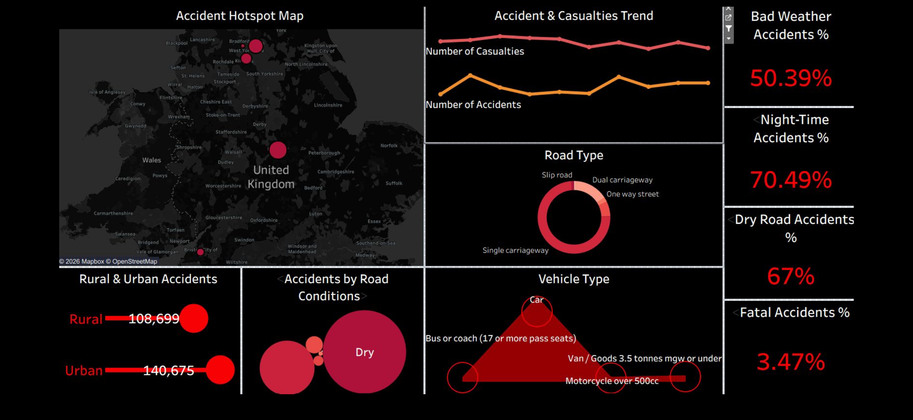

# 🚗 UK Traffic Safety & Accident Analytics Dashboard

## 📌 Project Overview
This is an independent analytics project built specifically to demonstrate my **dashboard design, data visualization, and analytical structuring skills**. 

> **Note:** This project is not connected to my primary professional domain. It was created independently using public data to showcase core Data Analytics & BI capabilities.

---

## 🖼️ Dashboard Preview

---

## 📊 Key Features & Visualizations
* **Accident Trends & Severity:** Overview of total accidents and breakdown by severity (Fatal, Serious, Slight).
* **Environmental Impact:** Analysis of how light, weather, and road surface conditions affect accident rates.
* **Vehicle & Casualty Insights:** Patterns across vehicle types and casualty demographics.

---

## 🛠️ Tools & Skills
* **Tools Used:** Tableau / Power BI
* **Skills Demonstrated:**
  * Data Preparation & KPI Definition
  * Visual Hierarchy & UI/UX Layout Design
  * Business Intelligence & Interactive Storytelling
